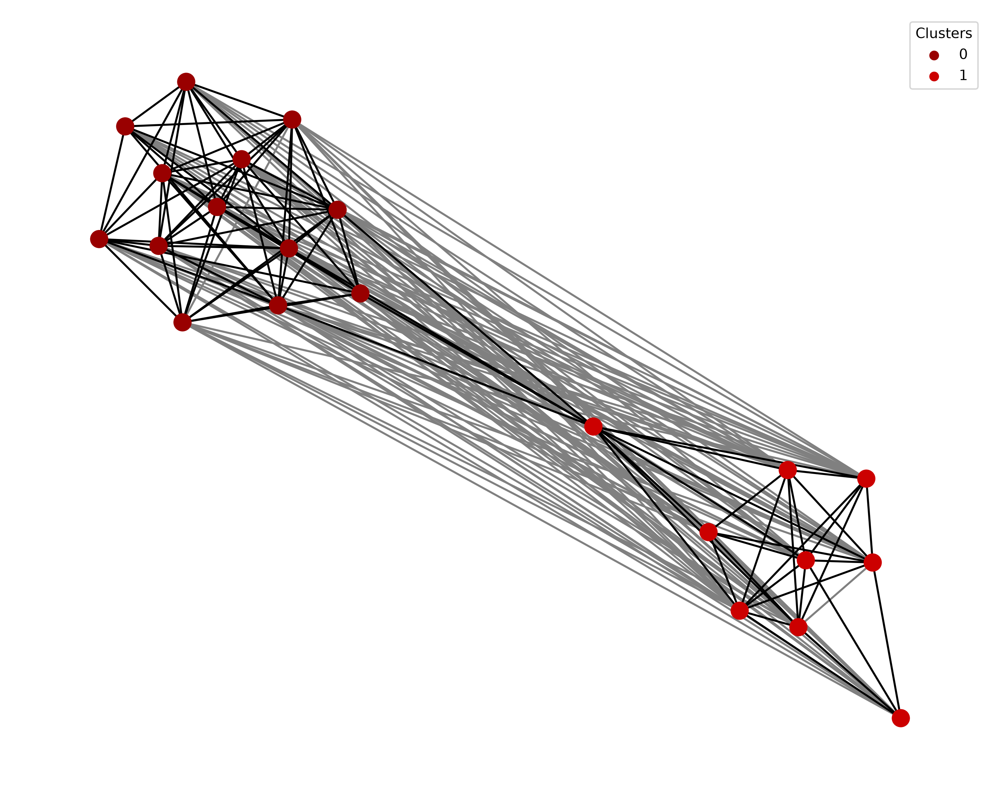

Working with Benchmark Datasets
===============================

Introduction
------------

Benchmark datasets help evaluate methods for studying word meaning and
semantic change. The ``languagechange.benchmark`` module provides classes
for several tasks, including Word-in-Context (WiC), Word Sense
Disambiguation (WSD), Word Sense Induction (WSI), and lexical semantic
change detection.

This tutorial follows ``benchmark_examples.py``. We will learn how to:

* Create and inspect a Word-in-Context dataset.
* Build datasets from target usages.
* Split data and evaluate predictions.
* Compare WSD sense labels with WSI cluster assignments.
* Load the benchmark resources selected in ``benchmark_examples.py``.
* Inspect DWUG graphs, generate model judgments, and cluster usages.
* Convert DWUG annotations into task datasets and evaluate semantic change.

.. contents:: In this tutorial
   :local:
   :depth: 2

Prerequisites
-------------

Make sure that ``languagechange`` and its dependencies are installed.
Run the examples in order in the same Python session or notebook. The
first examples use the small ``jam`` dataset from ``benchmark_examples.py``,
defined directly below. Later sections download the five selected resources
and the ``pierluigic/xl-lexeme`` model (approximately 2.24 GB of weights).
Use a writable dataset cache, network access for the first download, and
several GB of disk space for the extracted datasets and model weights.
XL-WSD extracts to approximately 1.3 GB, and its unrestricted WiC
conversion creates over 3.7 million pairs in this run.
The model examples use CPU inference.

How the tasks connect
---------------------

The examples share the same object of study: a target word used in context.
The distinction is the question asked about that usage:

.. list-table:: Related tasks
   :header-rows: 1
   :widths: 20 45 35

   * - Task
     - Question
     - Annotation or prediction
   * - WiC
     - Do two usages have the same meaning?
     - A pair label or relatedness score.
   * - WSD
     - Which predefined sense fits this usage?
     - A sense label for each usage.
   * - WSI
     - Which usages form meaning groups?
     - Cluster assignments, without predefined sense names.
   * - Semantic change
     - Does meaning differ between periods?
     - Binary change labels or graded change scores.

`The WSD slides
<https://docs.google.com/presentation/d/1EC7-ua6tG69dfQ5wtJFeAY-8tFPaurBadAgMNK_FJp4/edit>`_
explain the difference between selecting from a sense inventory (WSD) and
discovering meaning groups (WSI). A cluster number is an identifier, not
a dictionary definition.

DWUG means Diachronic Word Usage Graphs. Nodes represent usages, and edges
represent judgments of how related their meanings are. The human DURel
scale runs from 1 (unrelated) to 4 (identical). Clustering the graph groups
related usages; comparing groups across periods supports semantic change
analysis. See the `DURel Annotation Tool article
<https://blog.junge-sprachwissenschaft.de/2021/08/01/Schlechtweg-DURel-Annotation-Tool.html>`_.
This explains why a DWUG resource can supply WiC pairs, WSD labels, WSI
clusters, and change annotations in the same tutorial.

Creating a custom WiC dataset
-----------------------------

WiC (Word-in-Context) asks whether a word has the same meaning in two
different contexts.

For example, the word ``jam`` refers to a fruit preserve in ``Strawberry
jam`` and to traffic congestion in ``Traffic jam``. These uses have
different meanings. In ``Strawberry jam`` and ``Blueberry jam``, however,
the word has the same meaning.

We can represent these examples as dictionaries:

.. code-block:: python

   from languagechange.benchmark import WiC

   examples = [
       {
           "word": "jam",
           "text1": "Strawberry jam",
           "text2": "Traffic jam",
           "start1": 11, "end1": 14,
           "start2": 8, "end2": 11,
           "label": 0,
       },
       {
           "word": "jam",
           "text1": "Strawberry jam",
           "text2": "Blueberry jam",
           "start1": 11, "end1": 14,
           "start2": 10, "end2": 13,
           "label": 1,
       },
   ]

   wic = WiC(wic_data=examples)

The ``start`` and ``end`` values identify the target word's character
positions in each text. The labels in these examples use ``0`` for
different meanings and ``1`` for the same meaning.

Inspecting the dataset
----------------------

We can retrieve all examples and count them:

.. code-block:: python

   all_examples = wic.get_all_data()
   print(len(all_examples))

The output for this example is:

.. code-block:: text

   2

We can also inspect the target in each context using its offsets:

.. code-block:: python

   for example in all_examples:
       target1 = example["text1"][example["start1"]:example["end1"]]
       target2 = example["text2"][example["start2"]:example["end2"]]
       print(target1, target2, example["label"])

Output:

.. code-block:: text

   jam jam 0
   jam jam 1

Creating a dataset from target usages
-------------------------------------

If you already have ``TargetUsage`` objects, pass pairs of them with one
label per pair:

.. code-block:: python

   from languagechange.usages import TargetUsage

   target_usages = [
       TargetUsage("Strawberry jam", offsets=[11, 14]),
       TargetUsage("Traffic jam", offsets=[8, 11]),
       TargetUsage("Blueberry jam", offsets=[10, 13]),
   ]
   pairs = [
       (target_usages[0], target_usages[1]),
       (target_usages[0], target_usages[2]),
       (target_usages[1], target_usages[2]),
   ]
   paired_wic = WiC(wic_data=pairs, labels=[0, 1, 0])
   print(len(paired_wic.get_all_data()))
   print([example["label"] for example in paired_wic.get_all_data()])

Output:

.. code-block:: text

   3
   [0, 1, 0]

Evaluating predictions
----------------------

For the original two-example ``wic`` dataset, predictions must be in the
same order as the examples. Our custom data is stored under ``"all"``, so
we must select that dataset explicitly; the evaluation methods otherwise
default to ``"test"``.

First compare an all-zero baseline with predictions that reproduce the
gold labels:

.. code-block:: python

   baseline = [0, 0]
   matching_labels = [0, 1]
   print(f"Baseline accuracy: {wic.evaluate_accuracy(baseline, dataset='all'):.3f}")
   print(f"Baseline macro F1: {wic.evaluate_f1(baseline, dataset='all'):.3f}")
   print(f"Matching-label F1: {wic.evaluate_f1(matching_labels, dataset='all'):.3f}")

Output:

.. code-block:: text

   Baseline accuracy: 0.500
   Baseline macro F1: 0.333
   Matching-label F1: 1.000

These values demonstrate the evaluation API. They do not measure a
trained model: the perfect predictions were copied from the gold labels.
For graded WiC labels, ``evaluate_spearman()`` compares rankings of scores
instead of binary decisions.

Splitting the dataset
---------------------

``split_train_dev_test()`` creates partitions using proportions that sum
to one. A fixed seed makes shuffling reproducible. To illustrate the API
with just two examples, we put one in training and one in testing:

.. code-block:: python

   wic.split_train_dev_test(
       train_prop=0.5, dev_prop=0.0, test_prop=0.5, seed=42
   )
   print("Training examples:", len(wic.get_train()))
   print("Development examples:", len(wic.get_dev()))
   print("Test examples:", len(wic.get_test()))

Output:

.. code-block:: text

   Training examples: 1
   Development examples: 0
   Test examples: 1

The empty development partition is expected here. Use a larger dataset
and separate training, development, and test data for real evaluation.
Once a test partition exists, provide one prediction per test example
and use ``dataset="test"``.

Word Sense Disambiguation
-------------------------

WSD assigns a known sense label to each usage. Reuse the three usages,
with the food label assigned to the first and third sentences:

.. code-block:: python

   from languagechange.benchmark import WSD

   senses = ["food", "congestion", "food"]
   wsd = WSD(wsd_data=target_usages, labels=senses)
   print(len(wsd.get_all_data()))
   print(f"WSD macro F1: {wsd.evaluate_f1(senses, dataset='all'):.3f}")

Output:

.. code-block:: text

   3
   WSD macro F1: 1.000

Here too, using the gold labels as predictions only checks how evaluation
works. In an experiment, replace them with predictions from your model.

Word Sense Induction
--------------------

WSI groups usages into clusters. Unlike WSD, the numerical cluster names
do not have to match the gold sense names. What matters is which usages
are grouped together.

Cast the WSD dataset to WSI and evaluate a clustering that places the
two preserve usages together:

.. code-block:: python

   wsi = wsd.cast_to_WSI()
   clusters = [7, 2, 7]
   ari = wsi.evaluate_ari(clusters)
   purity = wsi.evaluate_purity(clusters)
   print(f"ARI for jam: {ari['ari']['jam']:.3f}")
   print(f"Purity for jam: {purity['purity']['jam']:.3f}")

Output:

.. code-block:: text

   ARI for jam: 1.000
   Purity for jam: 1.000

Adjusted Rand Index (ARI) and purity are returned per word by default.
Purity alone can reward splitting every usage into its own cluster, so
inspect it alongside other metrics and the usages themselves.

You can also construct WSI directly from the same usages and sense labels:

.. code-block:: python

   from languagechange.benchmark import WSI

   custom_wsi = WSI(wsi_data=target_usages, labels=senses)
   print(len(custom_wsi.get_all_data()))

Output:

.. code-block:: text

   3

Casting WSD to WiC
------------------

``cast_to_WiC()`` creates pairs of usages for each target word. Pairs
receive label ``1`` if their sense labels match, and ``0`` otherwise:

.. code-block:: python

   derived_wic = wsd.cast_to_WiC(random_seed=42)
   derived_examples = derived_wic.get_all_data()
   print(len(derived_examples))
   print(sorted(example["label"] for example in derived_examples))

Output:

.. code-block:: text

   3
   [0, 0, 1]

Three usages produce three pairs. For large datasets, use
``max_per_word`` to limit the number of generated pairs. Split data before
creating pairs when you need to keep train and test usages separate.

Built-in benchmark resources
----------------------------

``benchmark_examples.py`` also demonstrates downloadable resources. The
following table records its dataset selections:

.. list-table:: Datasets selected in benchmark_examples.py
   :header-rows: 1
   :widths: 18 32 18 18 14

   * - Class
     - Dataset
     - Language
     - Version
     - Subset
   * - ``WiC``
     - ``WiC``
     - ``EN``
     - ``1.0``
     - —
   * - ``WSD``
     - ``XL-WSD``
     - ``DA``
     - ``no-version``
     - —
   * - ``DWUG``
     - ``DWUG``
     - ``SV``
     - ``3.0.0``
     - —
   * - ``DWUG``
     - ``NorDiaChange``
     - ``NO``
     - ``no-version``
     - ``1``
   * - ``DWUG``
     - ``DWUG Sense``
     - ``DE``
     - ``1.0.0``
     - —
   * - ``SemEval2020Task1``
     - ``NorDiaChange``
     - ``NO``
     - ``no-version``
     - ``1``

Resource links: `WiC <https://pilehvar.github.io/wic/>`_,
`XL-WSD <https://github.com/SapienzaNLP/xl-wsd>`_,
`DWUG SV 3.0.0 <https://zenodo.org/records/14028906>`_,
`NorDiaChange <https://github.com/ltgoslo/nor_dia_change>`_,
`DWUG Sense DE 1.0.0 <https://zenodo.org/records/8197553>`_, and
`XL-LEXEME <https://huggingface.co/pierluigic/xl-lexeme>`_.

The resource manager downloads a selected dataset when it is absent from
its cache. ``no-version`` is the resource hub's selection key; it does not
pin the revision of an upstream repository. Record the downloaded revision
when an experiment needs strict reproducibility. Keep dataset source and
reuse conditions with any downloaded data. The examples below publish
counts and evaluation results rather than copies of the source sentences.

Loading the English WiC resource
--------------------------------

Inspect the downloaded partitions before changing them. In contrast to
the inline ``jam`` examples, these are usages from the WiC resource.

.. code-block:: python

   wic_en = WiC(dataset="WiC", language="EN", version="1.0")
   print("WiC partitions:", {
       name: len(wic_en.get_dataset(name)) for name in ("train", "dev", "test")
   })
   print("WiC examples:", len(wic_en.get_all_data()))

.. code-block:: text

   WiC partitions: {'train': 5428, 'dev': 638, 'test': 1400}
   WiC examples: 7466

``benchmark_examples.py`` creates new partitions using 80% for training,
19% for development, and 1% for testing. A fixed seed makes the split
repeatable for the same inputs and NumPy version. These are newly created
partitions, not the published evaluation split.

.. code-block:: python

   wic_en.split_train_dev_test(train_prop=0.8, dev_prop=0.19, test_prop=0.01, seed=42)
   print("WiC new partitions:", {
       name: len(wic_en.get_dataset(name)) for name in ("train", "dev", "test")
   })
   test_data = wic_en.get_test()
   predictions = [0] * len(test_data)
   print(f"Always-different macro F1: {wic_en.evaluate_f1(predictions):.3f}")

.. code-block:: text

   WiC new partitions: {'train': 5972, 'dev': 1419, 'test': 75}
   Always-different macro F1: 0.353

An always-different prediction is a baseline, not a trained model. Keep
labels separate from model inputs when evaluating a real system.

Loading Danish XL-WSD and evaluating WSI
----------------------------------------

Load the Danish selection from XL-WSD. The file layout determines which
published partitions are available.

.. code-block:: python

   from languagechange.benchmark import WSD

   wsd_da = WSD(dataset="XL-WSD", language="DA", version="no-version")
   print("XL-WSD partitions:", {
       name: len(wsd_da.get_dataset(name)) for name in ("train", "dev", "test")
   })
   print("XL-WSD examples:", len(wsd_da.get_all_data()))
   wsd_da.split_train_dev_test(train_prop=0.9, dev_prop=0.09, test_prop=0.01, seed=42)
   print("XL-WSD new partitions:", {
       name: len(wsd_da.get_dataset(name)) for name in ("train", "dev", "test")
   })

.. code-block:: text

   XL-WSD partitions: {'train': 61228, 'dev': 876, 'test': 3502}
   XL-WSD examples: 65606
   XL-WSD new partitions: {'train': 59045, 'dev': 5904, 'test': 657}

Cast the sense-labeled data to WSI. Copying the gold labels as predictions
checks the evaluation API; it is an oracle sanity check, not system
performance. WSD compares sense identities, while WSI measures agreement
between groupings. The printed WSI scores are unweighted means of the
per-word scores.

.. code-block:: python

   wsi_da = wsd_da.cast_to_WSI()
   oracle_predictions = {example["id"]: example["label"] for example in wsi_da.get_test()}
   print("Oracle WSD F1:", wsd_da.evaluate_f1(oracle_predictions, dataset="test"))
   from statistics import mean

   ari_by_word = wsi_da.evaluate_ari(oracle_predictions, dataset="test")["ari"]
   purity_by_word = wsi_da.evaluate_purity(oracle_predictions, dataset="test")["purity"]
   print("Oracle WSI ARI, mean across words:", mean(ari_by_word.values()))
   print("Oracle WSI purity, mean across words:", mean(purity_by_word.values()))
   print("Evaluated words:", len(ari_by_word))

.. code-block:: text

   Oracle WSD F1: 1.0
   Oracle WSI ARI, mean across words: 1.0
   Oracle WSI purity, mean across words: 1.0
   Evaluated words: 471

Converting the Danish WSD data to WiC forms pairs within each partition.
The fixed seed makes pair ordering repeatable for the same inputs.

.. code-block:: python

   wsd_da_wic = wsd_da.cast_to_WiC(random_seed=42)
   print("XL-WSD to WiC partitions:", {
       name: len(wsd_da_wic.get_dataset(name)) for name in ("train", "dev", "test")
   })

.. code-block:: text

   XL-WSD to WiC partitions: {'train': 3685342, 'dev': 35562, 'test': 510}

As in ``benchmark_examples.py``, this conversion includes all pairs.
For larger datasets, set ``max_per_word`` to limit pair generation because
the number of possible pairs grows quadratically.

Loading the three DWUG selections
---------------------------------

The script selects Swedish DWUG, Norwegian NorDiaChange subset 1, and German
DWUG Sense. They contain related annotations but serve different language
and sense-analysis settings. Load each selection explicitly:

.. code-block:: python

   from languagechange.benchmark import DWUG

   dwug_sv = DWUG(dataset="DWUG", language="SV", version="3.0.0")
   dwug_no = DWUG(dataset="NorDiaChange", language="NO", version="no-version", subset=1)
   dwug_de_sense = DWUG(
       dataset="DWUG Sense", language="DE", version="1.0.0", config="maj_3"
   )
   print("Swedish target words:", len(dwug_sv.target_words))
   print("Norwegian target words:", len(dwug_no.target_words))
   print("German sense target words:", len(dwug_de_sense.target_words))

.. code-block:: text

   Swedish target words: 44
   Norwegian target words: 40
   German sense target words: 24

Use ``config="maj_3"`` for this German sense dataset to load its supplied
statistics alongside the usage data.

Exporting Norwegian usage records
---------------------------------

Use the library's native writer to save the Norwegian usages. A missing
``description`` appears as ``" "`` (one space) in these exported records.
Each line is a JSON object containing one usage and its metadata.

.. code-block:: python

   from languagechange.usages import UsageDictionary

   norwegian_usages = UsageDictionary({"ørret": dwug_no.get_word_usages("ørret")})
   norwegian_usages.save("benchmark_exports/dwug_no")

The file is ``benchmark_exports/dwug_no/ørret_usages.jsonl``. The first
record from the verified export is:

.. literalinclude:: outputs/benchmarks_norwegian_usages.jsonl
   :language: json
   :lines: 1

:download:`Download the 22 Norwegian usage records
<outputs/benchmarks_norwegian_usages.jsonl>`. This is an unchanged copy of
the library-created export. Text and annotations come from
`NorDiaChange <https://github.com/ltgoslo/nor_dia_change>`_, distributed
under CC BY 4.0. Existing descriptions and usage metadata are preserved.

Understanding a Norwegian usage graph
--------------------------------------

A usage graph helps us inspect how a word is used in different contexts.
Here we use ``leilighet`` from NorDiaChange subset 1. Its supplied clusters
contain usages meaning an apartment and usages meaning an occasion.
We load the dataset's existing judgments and clusters to draw the graph.

.. code-block:: python

   from collections import Counter
   from pathlib import Path

   artifact_dir = Path("benchmark_artifacts")
   artifact_dir.mkdir(parents=True, exist_ok=True)
   graph_word = "leilighet"
   word_usages = dwug_no.get_word_usages(graph_word)
   word_graph, word_clusters = dwug_no.load_graph_from_csv(graph_word)
   graph_path = artifact_dir / "leilighet_graph.png"
   dwug_no.plot_graph(
       graph_word, save_to_file=True, outfile=str(graph_path),
       plot_cluster_labels=True,
   )
   print("Usages of leilighet:", len(word_usages))
   print("Graph nodes:", word_graph.number_of_nodes())
   print("Graph edges:", word_graph.number_of_edges())
   print("Supplied cluster sizes:", dict(sorted(Counter(word_clusters).items())))
   print("Graph saved:", graph_path.is_file())

Printed output:

.. code-block:: text

   Usages of leilighet: 22
   Graph nodes: 22
   Graph edges: 198
   Supplied cluster sizes: {0: 13, 1: 9}
   Graph saved: True

   All 22 usage nodes and 198 judgment edges for ``leilighet`` in
   NorDiaChange subset 1. Source: the
   `NorDiaChange dataset <https://github.com/ltgoslo/nor_dia_change>`_,
   distributed under `CC BY 4.0 <https://creativecommons.org/licenses/by/4.0/>`_.

Read the figure as follows:

* Each dot is one corpus usage of ``leilighet``.
* The legend's 0 and 1 are the supplied cluster IDs. Cluster 0 contains
  13 usages and cluster 1 contains nine. The numbers are identifiers,
  not a ranking of meanings.
* Black edges have median relatedness ratings of at least 2.5; gray edges
  fall below that threshold. All supplied judgment edges remain visible.
* Positions come from a graph layout, not a time axis. Being in separate
  groups does not by itself establish a change between historical periods.

For context, cluster 0 includes ``Genia hadde en liten leilighet i Paris``
(an apartment). Cluster 1 includes ``som ved tidligere leiligheter``
(on earlier occasions). These phrases are excerpts from the supplied
contexts and illustrate the difference; the cluster numbers themselves
do not provide dictionary definitions.

To inspect the full contexts, export the actual usage records:

.. code-block:: python

   UsageDictionary({graph_word: word_usages}).save("benchmark_exports/graph_word")

Download :download:`the 22 usage records
<outputs/benchmarks_leilighet_usages.jsonl>` and :download:`their supplied
cluster assignments <outputs/benchmarks_leilighet_clusters.tsv>`. Join them
by ``identifier`` to check the contexts behind the colors. Both downloads
are unchanged copies of the library-created usage export and dataset
cluster file, respectively.

Annotating egg with XL-LEXEME
-----------------------------

``XL_LEXEME`` embeds target words in their contexts. ``annotate_word()``
compares embeddings to generate pair judgments. Here, the score is cosine
similarity, not a human DURel rating. A threshold appropriate to human
ratings must not be reused blindly for these scores.

The tutorial uses all usages of ``egg``, as in ``benchmark_examples.py``,
and writes generated judgments separately from the downloaded annotations.
It uses the same XL-LEXEME model and runs it on CPU.

.. code-block:: python

   from languagechange.models.representation.contextualized import XL_LEXEME
   import csv
   import math

   xl_lexeme = XL_LEXEME(device="cpu")
   judgments_path = artifact_dir / "egg_judgments.csv"
   clusters_path = artifact_dir / "egg_clusters.csv"
   dwug_no.annotate_word(
       "egg", xl_lexeme, n_usages="all", random_seed=42,
       save_path=str(judgments_path),
   )
   with judgments_path.open() as handle:
       model_judgments = list(csv.DictReader(handle, delimiter="\t"))
   print("Model judgments:", len(model_judgments))
   print("Annotators:", sorted({row["annotator"] for row in model_judgments}))
   print("Cosine scores finite:", all(
       math.isfinite(float(row["judgment"])) for row in model_judgments
   ))

.. code-block:: text

   Model judgments: 231
   Annotators: ['XL_LEXEME']
   Cosine scores finite: True

For ``n`` usages, all pairs give ``n * (n - 1) / 2`` judgments. Model
weights are downloaded on the first run and reused from the Hugging Face
cache afterward.

Clustering the model judgments
------------------------------

Pass the generated file explicitly to ``cluster()`` so the clustering uses
model judgments rather than the downloaded human annotations. Save the
labels to a separate file as well. Cluster numbers have no intrinsic sense
names.

The default destinations are separate: ``annotate_word()`` writes
``data/judgments.csv``, while ``cluster("egg")`` looks for supplied judgments
in ``data/egg/judgments.[ct]sv`` (``judgments.tsv`` in this Norwegian resource).
To cluster your model-generated judgments, pass their path explicitly,
as below. The combined-method example uses explicit paths too.

.. code-block:: python

   model_graph, cluster_labels = dwug_no.cluster(
       "egg", judgments_file_or_dir=str(judgments_path),
       save_path=str(clusters_path), plot=False,
   )
   print("Clustered usages:", model_graph.number_of_nodes())
   print("Clusters:", len(set(cluster_labels)))
   print("Labels saved:", clusters_path.is_file())

.. code-block:: text

   Clustered usages: 22
   Clusters: 1
   Labels saved: True

In this run, all 22 usages were assigned to one cluster. This is
the output for these model scores and clustering settings. A cluster is a
model-generated grouping; interpreting it as a word sense requires
checking the contexts and comparing with the supplied annotations.

The convenience method combines annotation and clustering. Use it as an
alternative to the two calls above. Explicit paths keep both steps on the
same model-generated judgments and keep all generated files separate.

.. code-block:: python

   combined_judgments = artifact_dir / "egg_combined_judgments.csv"
   combined_clusters = artifact_dir / "egg_combined_clusters.csv"
   dwug_no.annotate_and_cluster(
       "egg", xl_lexeme, n_usages="all", random_seed=42,
       judgments_path=str(combined_judgments), clusters_path=str(combined_clusters),
       plot=False,
   )
   print("Combined judgments saved:", combined_judgments.is_file())
   print("Combined clusters saved:", combined_clusters.is_file())

.. code-block:: text

   Combined judgments saved: True
   Combined clusters saved: True

Converting Swedish DWUG into task datasets
------------------------------------------

A DWUG can supply several evaluation tasks. Pairwise relatedness judgments
become WiC examples; cluster assignments become WSD or WSI labels.
DWUG-derived WiC labels can be graded ratings, so do not assume they are
the binary labels from the English WiC resource.

.. code-block:: python

   dwic = dwug_sv.cast_to_WiC()
   dwsd = dwug_sv.cast_to_WSD()
   dwsi = dwug_sv.cast_to_WSI()
   print("DWUG WiC pairs:", len(dwic.get_all_data()))
   print("DWUG WSD usages:", len(dwsd.get_all_data()))
   print("DWUG WSI usages:", len(dwsi.get_all_data()))
   print("WiC pairs for dun:", len(dwic.get_data_by_word("all", "dun")))

.. code-block:: text

   DWUG WiC pairs: 35030
   DWUG WSD usages: 7845
   DWUG WSI usages: 7845
   WiC pairs for dun: 280

These conversions reuse supplied annotations. They do not train a WSD model
or establish a new dictionary sense inventory.

Evaluating lexical semantic change
----------------------------------

``SemEval2020Task1`` exposes change evaluation methods. With ``"NO"`` it
loads NorDiaChange, not a Norwegian dataset from the original SemEval-2020
shared task. Subset 1 is the same Norwegian selection loaded above.

.. code-block:: python

   from languagechange.benchmark import SemEval2020Task1

   semeval_no = SemEval2020Task1("NO", subset=1)
   same_usages = semeval_no.get_word_usages("ørret")
   print("NorDiaChange targets:", len(semeval_no.target_words))
   print("Usages of ørret:", len(same_usages))
   print("Same usage identifiers:",
         {u.identifier for u in same_usages}
         == {u.identifier for u in norwegian_usages["ørret"]})
   words = sorted(semeval_no.target_words)
   change_predictions = {word: float(index) for index, word in enumerate(words)}
   graded_result = semeval_no.evaluate_gcd(change_predictions)
   print(f"Enumeration baseline Spearman: {graded_result.statistic:.6f}")
   binary_predictions = {word: 0 for word in words}
   print(f"Always-unchanged accuracy: {semeval_no.evaluate_cd(binary_predictions):.6f}")

.. code-block:: text

   NorDiaChange targets: 40
   Usages of ørret: 22
   Same usage identifiers: True
   Enumeration baseline Spearman: -0.001260
   Always-unchanged accuracy: 0.675000

Alphabetical enumeration provides a repeatable demonstration baseline, not
a semantic change model. ``benchmark_examples.py`` enumerates a set;
sorting the target words here fixes the baseline assignment across runs. Spearman measures agreement between predicted and
gold change rankings; binary accuracy measures agreement on changed versus
unchanged labels. Neither measures individual usage sense accuracy.

Outputs saved as JSONL
----------------------

The usage exports contain one JSON object per line. Each record preserves
its source text, target offsets, date, and available metadata. Use the
``identifier`` field to match graph usages to their supplied cluster labels.

* :download:`Norwegian ørret usages: 22 records
  <outputs/benchmarks_norwegian_usages.jsonl>`.
* :download:`Norwegian leilighet usages: 22 records
  <outputs/benchmarks_leilighet_usages.jsonl>`.
* :download:`Supplied leilighet cluster labels, in TSV format
  <outputs/benchmarks_leilighet_clusters.tsv>`.

For example, these are the first two exported ``leilighet`` usages:

.. literalinclude:: outputs/benchmarks_leilighet_usages.jsonl
   :language: json
   :lines: 1-2

The graph image and model-generated judgments and cluster files are saved
in ``benchmark_artifacts/`` by the examples above. The Norwegian usage
exports are saved in ``benchmark_exports/dwug_no/`` and
``benchmark_exports/graph_word/``. Printed counts and evaluation scores
are shown beside the relevant code; they are separate from the usage data.

Summary
-------

We loaded and evaluated WiC and XL-WSD, inspected all three DWUG selections,
plotted a usage graph, generated XL-LEXEME judgments, clustered them, and
converted Swedish DWUG annotations into WiC, WSD, and WSI datasets. We also
used NorDiaChange through ``SemEval2020Task1`` to evaluate binary and graded
semantic change predictions. These workflows connect judgments about pairs,
sense assignments, discovered clusters, and changes between periods.
