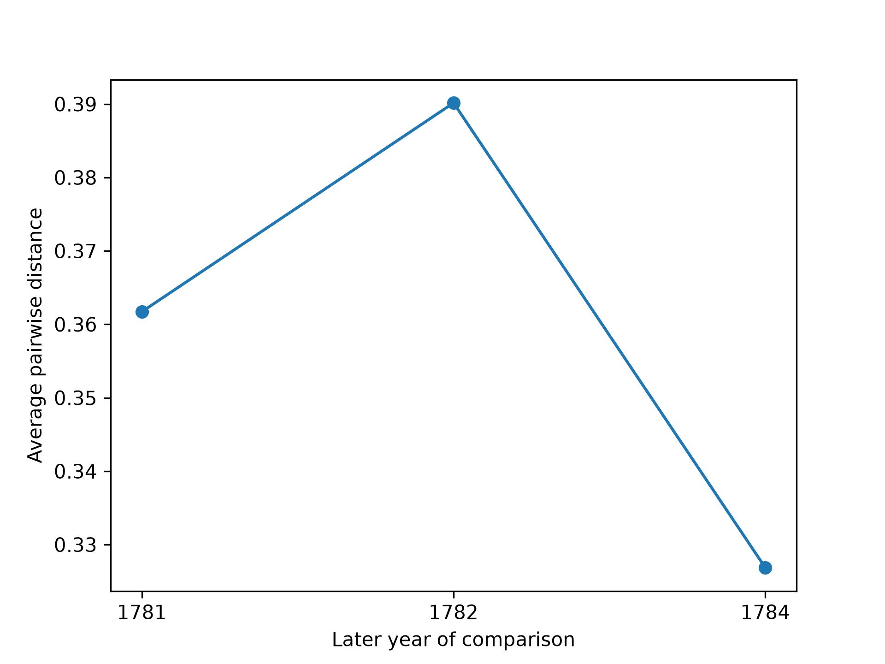
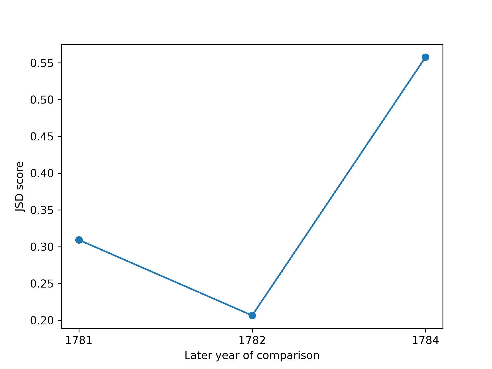

Comparing Word Usages over Time
===============================

Introduction
------------

This tutorial follows ``timeseries_examples.py`` to compare usages of the
Swedish lemma ``man`` across years. We sample 100 usages, encode the target
word in each context, and compute change scores between neighboring years.
We use average pairwise distance (APD) for embeddings and the library's
``JSD`` metric for cluster distributions. The results and inputs are saved
as JSONL and NumPy files, with graphs for inspection.

.. contents:: In this tutorial
   :local:
   :depth: 2

Prerequisites
-------------

Install ``languagechange`` and its dependencies. Download
:download:`the example Parquet corpus
<data/kubhist2-carlscronaswekoblad-1780.parquet>` and place it at
``corpora/kubhist2-carlscronaswekoblad-1780.parquet`` in your working folder.
The corpus comes from Språkbanken under CC BY 4.0; see :doc:`corpora` for
its citation and preparation.

This example uses ``pierluigic/xl-lexeme`` on the CPU. Its first use needs
network access to download the weights; later runs can reuse the model
cache. Batch size 2 reduces the memory needed for encoding.

Run the Python blocks in order in one session, or download
:download:`timeseries_examples.py
<../../examples/timeseries/timeseries_examples.py>` into your working
folder and run it from the terminal:

.. code-block:: console

   python timeseries_examples.py

Selecting usages
----------------

Search the corpus and sample 100 usages with a fixed seed:

.. code-block:: python

   from languagechange.corpora import ParquetCorpus
   from languagechange.search import SearchTerm

   corpus = ParquetCorpus("corpora/kubhist2-carlscronaswekoblad-1780.parquet")
   all_usages = corpus.search(SearchTerm(lemma="man"))["lemma=man"]
   usages = all_usages.sample(100, random_seed=42)
   print("All usages:", len(all_usages))
   print("Sample size:", len(usages))
   print([(str(year), len(items)) for year, items in usages.group_by_time().items()])

Printed output:

.. code-block:: text

   All usages: 480
   Sample size: 100
   [('1780', 14), ('1781', 23), ('1782', 61), ('1784', 2)]

These are 100 usages sampled from the whole result, not 100 per year.
The sample has no 1783 usages and only two usages from 1784. The seed
repeats the selection for the same input order and sampling environment.

Encoding the target words
--------------------------

XL-LEXEME represents the target word in each context as a numerical vector:

.. code-block:: python

   from languagechange.models.representation.contextualized import XL_LEXEME

   model = XL_LEXEME(device="cpu")
   embeddings = model.encode(usages, batch_size=2)
   print("Embedding shape:", embeddings.shape)
   print("One vector per usage:", len(embeddings) == len(usages))

Printed output:

.. code-block:: text

   Embedding shape: (100, 1024)
   One vector per usage: True

Each vector has 1,024 values. Embedding row 0 corresponds to usage 0, and
so on. Keep this order when saving the sample and its embeddings.

Grouping vectors by year
------------------------

Use one sorted list of years to construct both the embedding groups and
the time labels. This keeps each group attached to its correct year:

.. code-block:: python

   import numpy as np
   from languagechange.utils import _parse_year

   usage_years = [_parse_year(u.time) for u in usages]
   time_labels = sorted(set(usage_years))
   embs_list = [
       embeddings[np.array([year == label for year in usage_years])]
       for label in time_labels
   ]
   print("Year order:", [str(year) for year in time_labels])
   print("Group sizes:", [len(group) for group in embs_list])
   print("Total vectors:", sum(len(group) for group in embs_list))

Printed output:

.. code-block:: text

   Year order: ['1780', '1781', '1782', '1784']
   Group sizes: [14, 23, 61, 2]
   Total vectors: 100

The groups retain the original sample order within each year. Sorting
only the labels, while keeping embedding groups in a different order,
would attach scores to the wrong comparisons.

Computing APD
-------------

Average pairwise distance compares usage vectors from two year groups.
The default distance used here is cosine distance:

.. code-block:: python

   from languagechange.models.change.metrics import APD, JSD
   from languagechange.models.change.timeseries import TimeSeries

   ts_apd = TimeSeries(
       embeddings_or_cluster_labels=embs_list,
       change_metric=APD(),
       timeseries_type="consecutive",
       time_labels=time_labels,
   )
   print("Comparison years:", [str(year) for year in ts_apd.ts])
   print("APD scores:", ts_apd.series.tolist())

Printed output:

.. code-block:: text

   Comparison years: ['1781', '1782', '1784']
   APD scores: [0.3617127838122547, 0.39015425492081224, 0.3268529064232372]

``consecutive`` compares neighboring available groups: 1780–1781,
1781–1782, and 1782–1784. It does not insert the missing year. Each score
is labelled with the later year. A higher APD indicates more distant
embeddings, but does not by itself establish historical meaning change.

Computing JSD from embeddings
-----------------------------

Cluster all 100 vectors together, then compare the cluster distributions
in neighboring year groups:

.. code-block:: python

   from sklearn.cluster import AgglomerativeClustering

   clustering_algo = AgglomerativeClustering(
       n_clusters=None,
       distance_threshold=0.5,
       metric="cosine",
       linkage="complete",
   )
   ts_jsd_1 = TimeSeries(
       embeddings_or_cluster_labels=embs_list,
       change_metric=JSD(),
       clustering_algorithm=clustering_algo,
       timeseries_type="consecutive",
       time_labels=time_labels,
   )
   print("JSD scores:", ts_jsd_1.series.tolist())

Printed output:

.. code-block:: text

   JSD scores: [0.30926833345225363, 0.2064663669602392, 0.5575780139311987]

``distance_threshold`` controls clustering; it is not a change score.
Joint clustering gives comparable cluster labels across all years.
The library's ``JSD`` implementation calls SciPy's ``jensenshannon`` and
returns a Jensen–Shannon distance between the distributions.

Computing JSD from existing labels
----------------------------------

We can also compute cluster labels explicitly and pass them to
``TimeSeries``. Split the labels at the boundaries of the year groups:

.. code-block:: python

   from languagechange.models.meaning.clustering import Clustering

   combined_embeddings = np.concatenate(embs_list)
   labels = Clustering(clustering_algo).get_cluster_results(combined_embeddings).labels
   splits = np.cumsum([len(group) for group in embs_list][:-1])
   cluster_labels = np.split(labels, splits)
   ts_jsd_2 = TimeSeries(
       embeddings_or_cluster_labels=cluster_labels,
       change_metric=JSD(),
       timeseries_type="consecutive",
       time_labels=time_labels,
   )
   print("Number of clusters:", len(np.unique(labels)))
   print("Label group sizes:", [len(group) for group in cluster_labels])
   print("JSD from labels:", ts_jsd_2.series.tolist())
   print("JSD results match:", np.allclose(ts_jsd_1.series, ts_jsd_2.series))

Printed output:

.. code-block:: text

   Number of clusters: 9
   Label group sizes: [14, 23, 61, 2]
   JSD from labels: [0.30926833345225363, 0.2064663669602392, 0.5575780139311987]
   JSD results match: True

The two approaches give the same results. The nine clusters are algorithmic
groups; this example does not establish that each represents a distinct sense.

Saving scores and checking JSONL
--------------------------------

``TimeSeries.series`` contains the computed scores. Export each score with
its comparison years, using one JSON object per line:

.. code-block:: python

   from pathlib import Path
   import jsonlines

   output_dir = Path("outputs/timeseries_native")
   output_dir.mkdir(parents=True, exist_ok=True)
   series = {
       "apd_scores": ts_apd,
       "jsd_from_embeddings": ts_jsd_1,
       "jsd_from_labels": ts_jsd_2,
   }
   exports = {}
   for name, ts in series.items():
       records = [
           {"from_year": str(start), "to_year": str(end), "score": float(score)}
           for start, end, score in zip(time_labels[:-1], time_labels[1:], ts.series)
       ]
       exports[name + ".jsonl"] = records
   exports["cluster_labels.jsonl"] = [
       {"year": str(year), "labels": group.tolist()}
       for year, group in zip(time_labels, cluster_labels)
   ]
   for filename, records in exports.items():
       with jsonlines.open(output_dir / filename, mode="w") as writer:
           writer.write_all(records)
       with jsonlines.open(output_dir / filename) as reader:
           assert list(reader) == records
   print("Score records per file:", len(exports["apd_scores.jsonl"]))
   print("Saved year groups:", len(exports["cluster_labels.jsonl"]))
   print("Saved labels:", sum(len(record["labels"]) for record in exports["cluster_labels.jsonl"]))
   print("Readback matches: True")

Verified output:

.. code-block:: text

   Score records per file: 3
   Saved year groups: 4
   Saved labels: 100
   Readback matches: True

``from_year``, ``to_year``, and ``score`` are field names chosen for this
export; the values come from the actual year labels and computed scores.
There is no built-in ``TimeSeries.save()`` used here. Counts and other
printed messages are not part of the score records.

Preserving the sample and embeddings
------------------------------------

Save the sampled usage objects with the library's writer and save the
original, sample-ordered embedding array as NPY:

.. code-block:: python

   from languagechange.usages import UsageDictionary

   UsageDictionary({"lemma=man": usages}).save(str(output_dir / "sample"))
   embeddings_path = output_dir / "usage_embeddings.npy"
   np.save(embeddings_path, embeddings)
   saved_embeddings = np.load(embeddings_path, allow_pickle=False)
   with jsonlines.open(output_dir / "sample/lemma=man_usages.jsonl") as reader:
       saved_sample = list(reader)
   print("Saved embedding shape:", saved_embeddings.shape)
   print("Embeddings match:", np.array_equal(saved_embeddings, embeddings))
   print("Saved usages:", len(saved_sample))
   print("Text matches:", [r["text"] for r in saved_sample] == [u.text() for u in usages])
   print("Offsets match:", [r["offsets"] for r in saved_sample] == [u.offsets for u in usages])
   print("Dates match:", [r["time"] for r in saved_sample] == [str(u.time) for u in usages])

Verified output:

.. code-block:: text

   Saved embedding shape: (100, 1024)
   Embeddings match: True
   Saved usages: 100
   Text matches: True
   Offsets match: True
   Dates match: True

NPY row order matches the saved sample. Cluster-label records instead use
the chronological groups constructed earlier; regroup the sample's vectors
by year before matching them to those labels.

Saving and reading the graphs
-----------------------------

Use the noninteractive ``Agg`` backend to save figures without opening a
window. The library's plotting method otherwise calls ``plt.show()``:

.. code-block:: python

   import matplotlib.pyplot as plt

   plt.switch_backend("Agg")
   ts_apd.plot(
       xlabel="Later year of comparison",
       ylabel="Average pairwise distance",
       save_f=str(output_dir / "apd_scores.png"),
   )
   plt.close("all")
   ts_jsd_1.plot(
       xlabel="Later year of comparison",
       ylabel="JSD score",
       save_f=str(output_dir / "jsd_from_embeddings.png"),
   )
   plt.close("all")

   APD peaks at the comparison 1781–1782, labelled 1782.

   JSD peaks at the comparison 1782–1784, labelled 1784.

Each x-axis label is the later year of a comparison. The plot uses equally
spaced categories, so the gap to 1784 does not represent a single calendar
year. Matplotlib's message about categorical year strings is informational.
The two JSD approaches have identical scores and overlapping graph values;
the downloadable script saves both graphs.

APD measures distances between embeddings, while JSD compares cluster
distributions. Their patterns need not match. Only two sampled usages
represent 1784, so that year's distribution is particularly sensitive to
the sample. These scores illustrate the workflow and are not evidence on
their own that a historical meaning change occurred.

Outputs saved as JSONL
----------------------

Actual APD score records:

.. literalinclude:: outputs/timeseries_apd_scores.jsonl
   :language: json

Actual JSD records computed from embeddings:

.. literalinclude:: outputs/timeseries_jsd_from_embeddings.jsonl
   :language: json

Actual JSD records computed from cluster labels:

.. literalinclude:: outputs/timeseries_jsd_from_labels.jsonl
   :language: json

Download the complete results and inputs:

* :download:`APD scores <outputs/timeseries_apd_scores.jsonl>`.
* :download:`JSD scores from embeddings <outputs/timeseries_jsd_from_embeddings.jsonl>`.
* :download:`JSD scores from labels <outputs/timeseries_jsd_from_labels.jsonl>`.
* :download:`Cluster labels for all four years <outputs/timeseries_cluster_labels.jsonl>`.
* :download:`The 100 sampled usages <outputs/timeseries_sample_usages.jsonl>`.
* :download:`Sample-aligned 100 × 1,024 embeddings <outputs/timeseries_usage_embeddings.npy>`.
* :download:`APD graph <images/timeseries_apd_scores.png>`.
* :download:`JSD graph <images/timeseries_jsd_from_embeddings.png>`.
* :download:`timeseries_examples.py <../../examples/timeseries/timeseries_examples.py>`.

The full run saves results in ``outputs/timeseries_native`` in the usecases
folder. The downloadable script also writes ``run_metadata.json`` with its
settings, input checksums, package versions, and verification results.
Execution succeeded, and the saved records matched the calculated values.

Summary
-------

Sample usages, encode their targets, group vectors in chronological order,
and compute consecutive APD and JSD scores. Verify agreement between the
JSD approaches, save actual records as JSONL, and preserve the sample and
embeddings in matching order. Read the graphs alongside the sample sizes
before interpreting differences between years.
