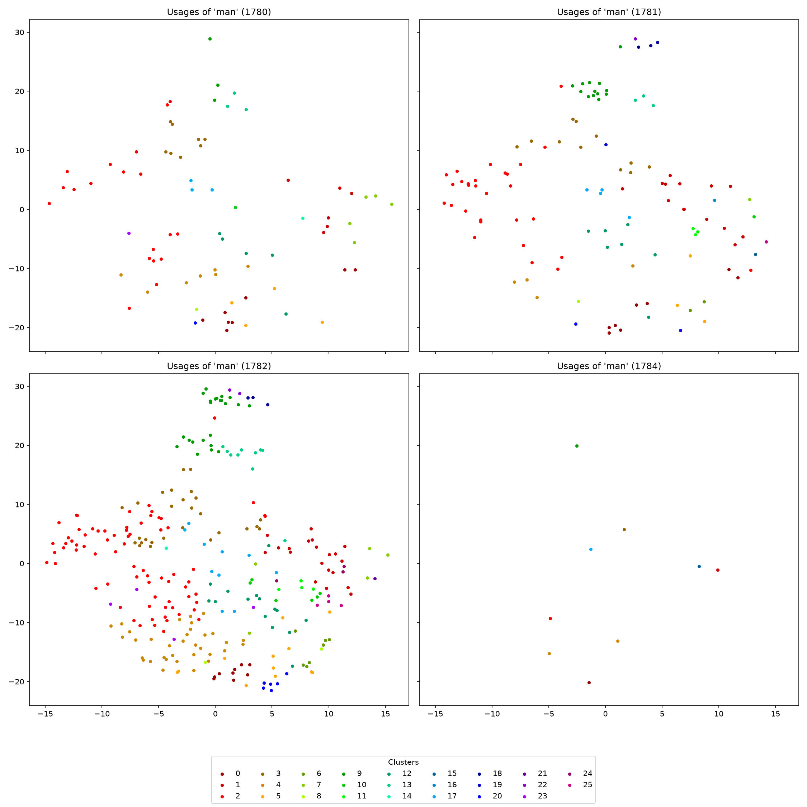

Visualizing Word Usages by Year
===============================

Introduction
------------

This tutorial follows ``visualization_examples.py`` to explore the Swedish
lemma ``man``. We find its contexts, represent each target word with
XL-LEXEME, group similar vectors, and draw one panel per year. We also
inspect the original sentences and save the results for later use.

.. contents:: In this tutorial
   :local:
   :depth: 2

Prerequisites
-------------

Install ``languagechange`` and its dependencies. Download
:download:`the example Parquet corpus
<data/kubhist2-carlscronaswekoblad-1780.parquet>` and put it in
``corpora/kubhist2-carlscronaswekoblad-1780.parquet`` in your working folder.
The corpus comes from Språkbanken under CC BY 4.0; see :doc:`corpora` for
the citation and preparation details.

XL-LEXEME runs on the CPU here. The first run needs network access to
download its weights. We use batch size 2 to reduce memory use during
encoding. Run the following Python blocks in order in one session.

Alternatively, download :download:`visualization_examples.py
<../../examples/visualizations/visualization_examples.py>` and run this
command in the terminal from your working folder:

.. code-block:: console

   python visualization_examples.py

Finding and grouping the usages
-------------------------------

Search for the lemma and group the matches by year:

.. code-block:: python

   from pathlib import Path
   from languagechange.corpora import ParquetCorpus
   from languagechange.search import SearchTerm

   output_dir = Path("outputs/visualization_native")
   output_dir.mkdir(parents=True, exist_ok=True)
   corpus = ParquetCorpus("corpora/kubhist2-carlscronaswekoblad-1780.parquet")
   all_usages = corpus.search(SearchTerm(lemma="man"))["lemma=man"]
   usages = all_usages.group_by_time()
   years = sorted(usages)
   print("Total usages:", len(all_usages))
   print("Year groups:", [(str(year), len(usages[year])) for year in years])

Printed output:

.. code-block:: text

   Total usages: 480
   Year groups: [('1780', 76), ('1781', 114), ('1782', 281), ('1784', 9)]

We use all 480 matches, grouped into the four years shown above.

Encoding and clustering
-----------------------

Encode each usage into a vector of 1,024 values. Keep the same sorted
year order when joining the arrays:

.. code-block:: python

   import numpy as np
   from languagechange.models.representation.contextualized import XL_LEXEME

   model = XL_LEXEME(device="cpu")
   embeddings = {year: model.encode(usages[year], batch_size=2) for year in years}
   vectors = np.concatenate([embeddings[year] for year in years])
   print("Embedding shape:", vectors.shape)

Printed output:

.. code-block:: text

   Embedding shape: (480, 1024)

Cluster all years together so that a cluster label has the same meaning
across the panels:

.. code-block:: python

   from sklearn.cluster import AgglomerativeClustering
   from languagechange.models.meaning.clustering import Clustering

   clustering = Clustering(AgglomerativeClustering(
       n_clusters=None, metric="cosine",
       distance_threshold=0.5, linkage="complete",
   ))
   labels = clustering.get_cluster_results(vectors).labels
   print("Number of clusters:", len(np.unique(labels)))

Printed output:

.. code-block:: text

   Number of clusters: 26

Cosine distance compares vector directions. Complete linkage uses the
largest distance between members of two groups when merging them. The
threshold controls where merging stops. These 26 groups are automatic
clusters, not 26 confirmed dictionary meanings.

Drawing the graph
-----------------

Pass the usages, embeddings and labels to ``Visualizer``. It joins the
year groups in chronological order. Check that the resulting vectors
still match the array used for clustering:

.. code-block:: python

   from languagechange.visualization import Visualizer

   visualizer = Visualizer(
       usages, embeddings=embeddings, cluster_labels=labels,
       target="man", cache_dir=str(output_dir / "cache"),
   )
   print("Group boundaries:", visualizer.indices.tolist())
   print("Embeddings aligned:", np.array_equal(visualizer.embeddings, vectors))

Printed output:

.. code-block:: text

   Group boundaries: [0, 76, 190, 471, 480]
   Embeddings aligned: True

The boundaries mark where each year's rows begin and end. For example,
rows 0 through 75 belong to 1780.

Use t-SNE to reduce the vectors to two coordinates. A fixed random seed
makes this step repeatable with the same inputs and software environment.
Place one shared legend below the panels to keep the dots visible:

.. code-block:: python

   import matplotlib.pyplot as plt

   plt.switch_backend("Agg")
   visualizer.plot_usage_embeddings(
       ncols=2, random_state=42, plot_cluster_labels=False, plot=False,
   )
   figure = plt.gcf()
   legend_entries = {}
   for axis in figure.axes:
       handles, names = axis.get_legend_handles_labels()
       legend_entries.update(zip(names, handles))
   names = sorted(legend_entries, key=int)
   figure.legend(
       [legend_entries[name] for name in names], names,
       title="Clusters", loc="lower center", ncol=9,
   )
   figure.tight_layout(rect=(0, 0.10, 1, 1))
   graph_path = output_dir / "usage_embeddings_by_year.png"
   figure.savefig(graph_path, dpi=150)
   plt.close(figure)

   A joint t-SNE projection split into four year panels.

Each dot represents one usage. The same color and cluster number refer
to the same group across all panels. There are more dots in 1782 because
it has 281 matches; 1784 has only nine. All panels use the same projection
and axis limits, so the dots retain their positions across years.

Nearby points suggest similar representations, but t-SNE is a visual
summary. Its axes are not years or change scores, and the plot alone does
not establish that a word's meaning changed. Read the contexts to
understand what a cluster contains.

Reading the contexts
--------------------

In a notebook, ``visualizer.display_usages(clusters=0, sort=True,
max_usages=3, randomize=False)`` displays three examples with the target
word highlighted. In a terminal, use ``text_formatting`` to print them:

.. code-block:: python

   from languagechange.visualization import text_formatting

   example_indices = np.flatnonzero(visualizer.cluster_labels == 0)[:3]
   print("\n\n".join(
       text_formatting(visualizer.usages[int(i)], visualizer.usages[int(i)].time)
       for i in example_indices
   ))

Printed output:

.. code-block:: text

   1780-01-08:	Du gör , at **man** de fulla stop , Sä gärna wil omarma .

   1780-01-08:	Du gört at **man** ser alla fjät , Som hwitå jorden näka .

   1780-01-08:	Du gör , ar marken blir sä hwit , ' Som Duphoes hwitå händer.- Du gör , ar **man** knapr liten bit Sig .

The asterisks mark the target word. Historical spelling and source text
are kept unchanged. Cluster 0 is an identifier assigned by this run.

Saving and checking the results
-------------------------------

Save the native usage records and their aligned vectors. The graph's
two-dimensional coordinates are already in the visualizer's cache;
copy that array to a clearly named output file:

.. code-block:: python

   from languagechange.usages import UsageDictionary
   from languagechange.visualization import generate_cache_key

   UsageDictionary({"lemma=man": visualizer.usages}).save(str(output_dir / "usages"))
   np.save(output_dir / "usage_embeddings.npy", vectors)
   key = generate_cache_key({"emb": vectors, "random_state": 42, "perplexity": 30})
   coordinates = np.load(
       Path(visualizer.cache_mgr.cache_dir) / f"{key}.npy", allow_pickle=False,
   )
   np.save(output_dir / "reduced_embeddings.npy", coordinates)

Save the actual cluster assignments in a separate JSONL file. Here
``usage_index`` is a zero-based row position shared by the usages,
embeddings and coordinates; it is not an identifier from the corpus:

.. code-block:: python

   import jsonlines

   cluster_records = [
       {"usage_index": i, "year": str(year), "cluster": int(labels[i])}
       for group, year in enumerate(visualizer.time_labels)
       for i in range(int(visualizer.indices[group]), int(visualizer.indices[group + 1]))
   ]
   with jsonlines.open(output_dir / "cluster_labels.jsonl", mode="w") as writer:
       writer.write_all(cluster_records)
   with jsonlines.open(output_dir / "usages/lemma=man_usages.jsonl") as reader:
       saved_usages = list(reader)
   with jsonlines.open(output_dir / "cluster_labels.jsonl") as reader:
       saved_clusters = list(reader)
   print("Saved usages:", len(saved_usages))
   print("Text matches:", [r["text"] for r in saved_usages] == [u.text() for u in visualizer.usages])
   print("Offsets match:", [r["offsets"] for r in saved_usages] == [u.offsets for u in visualizer.usages])
   print("Dates match:", [r["time"] for r in saved_usages] == [str(u.time) for u in visualizer.usages])
   print("Cluster labels match:", saved_clusters == cluster_records)
   print("Embeddings match:", np.array_equal(np.load(output_dir / "usage_embeddings.npy", allow_pickle=False), vectors))
   print("Reduced shape:", coordinates.shape)

Printed output:

.. code-block:: text

   Saved usages: 480
   Text matches: True
   Offsets match: True
   Dates match: True
   Cluster labels match: True
   Embeddings match: True
   Reduced shape: (480, 2)

Outputs
-------

Files are stored in ``outputs/visualization_native``. These downloads
contain the actual records and arrays used for the example:

* :download:`Usage records: 480 JSONL records <outputs/visualization_usages.jsonl>`
* :download:`Cluster assignments: 480 JSONL records <outputs/visualization_cluster_labels.jsonl>`
* :download:`Usage embeddings: 480 × 1024 NumPy array <outputs/visualization_usage_embeddings.npy>`
* :download:`Plot coordinates: 480 × 2 NumPy array <outputs/visualization_reduced_embeddings.npy>`
* :download:`Graph as PNG <images/visualization_usage_embeddings_by_year.png>`
* :download:`Run settings <outputs/visualization_run_metadata.json>`

First three saved cluster assignments:

.. literalinclude:: outputs/visualization_cluster_labels.jsonl
   :language: json
   :lines: 1-3

Summary
-------

We found 480 usages of ``man``, encoded them with XL-LEXEME, and grouped
them into 26 clusters. The four year panels share one t-SNE projection.
Reading the contexts helps interpret the groups, while the aligned JSONL
and NumPy exports let us return to each plotted usage.
